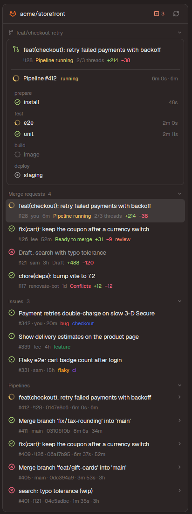

# GitLab panel for Herdr

A [Herdr](https://herdr.dev) side panel beside Files and Changes with the focused repo's GitLab:
this branch's merge request and pipeline, open merge requests, issues and recent pipelines.

- A merge request opens in the panel: approve, merge (squash, delete branch, auto-merge), mark
  draft/ready, close, threads with replies and resolving, comments, every file's diff.
- Merge requests and issues check out as worktree spaces, optionally with an agent started on
  them: the issue, or a review of the merge request, as its first message.
- Jobs open their log in a terminal; failed jobs and pipelines retry, running ones cancel.
- A notification when your pipeline finishes.
- Everything goes through [glab](https://gitlab.com/gitlab-org/cli); the browser is only a
  right-click item.



## Install

You need Herdr, `git`, `python3`, and glab signed in to your GitLab:

```sh
glab auth login --hostname <your GitLab host>
```

With Herdr open:

```sh
git clone https://github.com/rem-aster/herdr-gitlab ~/.local/share/herdr-gitlab
python3 ~/.local/share/herdr-gitlab/install.py
```

A **GitLab** button shows up in the tab bar, next to Changes. Herdr replaces its own layouts and
mods on every start, so the installer makes personal copies of the shown layout and its tab bar
(`main-gitlab`, `tabs-gitlab`), puts the panel in them and switches to them; a layout of your own
is edited in place. `ctrl-shift-l` switches layouts back.

Or ask your agent in Herdr: *"add the mod herdr.dev/mods/rem-aster/herdr-gitlab"* — it follows
[RECIPE.md](RECIPE.md).

**Update:** `git -C ~/.local/share/herdr-gitlab pull && python3 ~/.local/share/herdr-gitlab/install.py`
(again, it only updates the mod).

**What it runs:** `git`, `glab`, `sh` and `sed` on your machine (or the space's machine); glab
reaches your GitLab with its own login. It writes to GitLab only when you act: approve, merge,
comment, retry, create a merge request (which pushes the branch first).

## Use

- **Click** a merge request to open it, a job for its log, a pipeline or issue to unfold it, a
  changed file for its diff; Esc goes back.
- **Right-click** merge requests, pipelines, jobs, issues, threads, files and the project name for
  their actions and links (Open in GitLab, Copy link).
- **Worktrees** go to `~/.herdr/worktrees/<repo>/<branch>`, where Herdr's own worktree dialog puts
  them, as a new space; a branch that's checked out already is reused. An issue's branch is
  `<iid>-<title>`, which GitLab links to the issue.

## Develop

The mod is `mods/gitlab/`; [RECIPE.md](RECIPE.md) describes how it's built. After a change:
`python3 install.py`, `herdr-app check ~/.config/herdr-app/mods/gitlab`, and look at it in Herdr
(`check` doesn't run the async states). A block with `props: { "demo": true }` shows made-up data
(`demo.js`), for screenshots.

MIT licensed.
