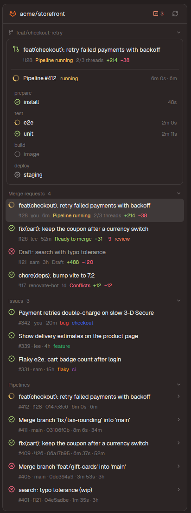

# GitLab panel

A side panel beside Files and Changes with the focused repo's GitLab: this branch's merge
request and pipeline, open merge requests, issues and recent pipelines. A merge request opens in
the panel itself (approve, merge, threads, comments, file diffs); merge requests and issues check
out as worktree spaces, optionally with an agent started on them. Everything goes through `glab`;
the browser is only ever a right-click item.

It runs programs and reaches the network: `git`, `glab`, `sh` and `sed`, on this machine or the
space's (`exec`); glab talks to the repo's GitLab with its own login. It writes to GitLab only on
the person's click (approve, merge, comment, retry, create a merge request — which pushes the
branch first), and outside its folder only by making worktrees in `~/.herdr/worktrees`.

## What you see

- **Tab bar:** a `GitLab` button (tanuki icon, 14 px, tinted) after Files and Changes, `selected`
  background while the panel shows it. The panel is remembered per space like the other two.
- **Panel** (the `panel-body` stack of Herdr's main layout, block id `gitlab`, 368 px, min 280): a
  card, radius 10, theme `background`, 1 px `border`, 13 px text.
  - **Header** 42 px: tanuki in `#fc6d26`, the project path (semibold; click or right-click: the
    project's links), the to-do count in `accent` when above 0, a refresh button (a spinner while
    loading).
  - **Sections**, headers 11 px medium `dim`; a click folds one (remembered):
    1. **The branch** (branch icon + name): a card (`surface`, radius 8) with its merge request
       (title 13 px medium; `!iid`, merge status in its color, `resolved/resolvable threads`,
       `+add −del`) or "No merge request" with a `Create MR` button; below, its pipeline
       (`Pipeline #iid`, status word, duration · age) and every job under its stage name.
    2. **Merge requests** (count): two-line rows, the head pipeline's status icon, the title
       (`muted` when draft), `!iid · author ("you") · age · merge status · threads · +/−`,
       `review` in `accent` when you're a reviewer, a folder icon in `accent` when a space is on its
       branch; the current branch's row `selected`.
    3. **Issues** (count): the first five, then `Show N more`; issue icon (`ansi2`), title,
       `#iid · assignee · age`, up to three labels in their own colors, a folder icon when a space
       is on the issue's branch. A click unfolds its description (markdown) and two buttons:
       `Worktree…` / `Go to worktree` and `With an agent…` / `Start an agent…`.
    4. **Pipelines**: the first five (skipped ones left out), `Show N more`; status icon, commit
       title, `#iid · ref or !iid · sha · duration · age`, a chevron; a click unfolds the jobs.
  - **Merge request view** (click one): back arrow, `!iid` and its state, refresh, `⋯` (its menu);
    the title 14 px semibold; `source → target · author · age`; merge status, approvers ("No
    approvals"), files and `+/−`; buttons `Approve` / `Revoke approval`, `Merge…` (solid when
    mergeable), `Worktree` / `Go to worktree`, `Review with agent…`; the pipeline card;
    **Description** (markdown); **Threads** (cards; open ones with a yellow `ansi3` border, resolved
    ones folded to one line; `Reply`, `Resolve`/`Unresolve`, `file:line` opens that file's diff);
    **Changes** (rows: `A`/`M`/`D`/`R` in `ansi2`/`blocked`/`ansi1`/`ansi4`, folder `dim` + file
    name, `+/−`). At the bottom, a comment field and a send button (a reply when `Reply` was
    clicked, with a line to cancel it).
  - **Diff view** (click a file): back arrow, file name, folder, `+/−`; the terminal font at 11 px,
    20 px rows, added lines tinted `ansi2` and removed `ansi1` (`18` alpha), line numbers, a
    horizontal scrollbar.
- **Statuses:** passed `ansi2` check, failed `ansi1` cross (allowed to fail: `ansi3` warning),
  running a `working` spinner, pending `ansi3`, manual `muted`, skipped/canceled/created `dim`.

## How it behaves

- **The repo** is the focused pane's folder, as Files and Changes take it, and its branch. The
  GitLab host and project come from the git remote (`origin`, else the first); a GitHub remote
  gets a message instead.
- **Data:** one GraphQL query per refresh (`glab api graphql --hostname <host>`): every 15 s
  while a pipeline runs, else 60 s; while the panel is hidden 60 s / 180 s; when it opens and the
  data is older than 15 s; after every action. The merge request view adds one query and the REST
  diffs (first 100 files).
- **Notifications:** a pipeline you started, or this branch's, that stops running posts
  `Pipeline passed / failed / canceled`.
- **Clicks:** a merge request opens its view; a job opens its log in a terminal split below
  (`glab ci trace`, GitLab 18's timestamp prefixes and section markers stripped with `sed -u`;
  Enter closes it); a pipeline or issue unfolds; a file opens its diff; Esc or the arrow goes back.
  Hovering a failed job shows a retry button.
- **Right-click** (a popup, 236 px): merge request — Approve / Revoke approval, Merge…, Mark as
  draft / ready, Open / Go to worktree, Review with an agent…, Copy branch name, Copy link, Open in
  GitLab, Close merge request… / Reopen; pipeline — Retry failed jobs, Cancel pipeline, links; job
  — Show log, Retry, links; issue — Open worktree… / Go to worktree, Open worktree with an agent… /
  Start an agent on it…, links; thread — Resolve / Unresolve, links; file — Copy path, Open diff in
  GitLab; the project name — the project, its merge requests, pipelines, issues and your to-do list
  in GitLab. ↑↓ Enter work. Slow items show a spinner in the popup until they're done.
- **Dialogs:** Merge — delete source branch, squash (fixed by the project's `squash_option` when
  it says always/never), "Merge when the pipeline succeeds" while one runs; disabled, with the
  reason, unless GitLab says mergeable; merges exactly the reviewed head (`sha`). Close — a
  confirm. Create MR — title from the commits, Draft, delete branch; pushes the branch first;
  disabled with no commits ahead. Issue worktree — branch `<iid>-<title, transliterated, ≤40>`
  (GitLab links it to the issue) or the issue's existing branch (local, else on the remote), an
  optional agent. Review — an agent. Agents are `knownAgents()` that are installed, most picked
  first; the task is the issue (title, link, description) or the merge request plus how to diff it.
- **Worktrees** go to `~/.herdr/worktrees/<repo>/<branch, / as ->` (where Herdr's own worktree
  dialog puts them) as a new unnamed space. A branch already checked out anywhere is reused (its
  space selected, or a space opened on it; an agent then gets a new tab). Remote branches are
  tracked; a new issue branch starts from `<remote>/<default branch>` untracked; a fork's merge
  request is fetched from its merge-request ref as `mr-<iid>`.

## Built from

- `mods/gitlab/`: `main.js` (the panel; a popup copy for `props.menu`; a dialog copy for
  `props.dialog`), `api.js` (git, glab, GraphQL and REST, worktrees), `menu.js` (menus as data,
  their actions), `dialogs.js`, `ui.js` (statuses, buttons; `MOD`, the folder name), `util.js`
  (pure helpers), `demo.js` (made-up data for a block with `props: { "demo": true }`, for
  screenshots), `icons/` (Lucide-style SVGs, tinted), `mod.json` `{ "place": "none" }`.
- **The layout:** a personal clone of Herdr's `main` whose `tabs` block shows a clone of `tabs`, and
  whose `panel-body` stack gets `{ "id": "gitlab", "type": "block", "content": { "mod": "gitlab" } }`.
- **The tab bar clone**, two edits to Herdr's `tabs/main.js`:
  `const enabled = [...(shared("workspace.panels") ?? ["files", "changes"]), "gitlab"];` and, after
  the Changes button,
  `.when(enabled.includes("gitlab"), el => el.child(panelButton("gitlab", "GitLab", "mods/gitlab/icons/gitlab.svg")))`.
- **herdr:** `spaces`, `panes`, `focused`, `layout`, `theme`, `settings`, `props`, `shared` /
  `setShared` (`gitlab.bump` reloads the panel after a popup's or dialog's action), `openOverlay` /
  `closeOverlay`, `notify`, `run` (`terminal.open`, `space.new`, `space.select`, `tab.new`),
  `exec`, `knownAgents`, `home`; `cx.open_url`, `cx.write_to_clipboard`.
- **Programs:** `git`, `glab` (logged in to the GitLab host), `sh`, `sed`.
- **GitLab:** GraphQL (`currentUser`, a project's merge requests, pipelines with stages and jobs,
  issues; a merge request's discussions and diff stats; `mergeRequestSetDraft`), REST through
  `glab api` (merge request diffs, approve / unapprove, merge, `state_event`, notes, discussion
  replies and resolving, job and pipeline retry, pipeline cancel, creating a merge request, the
  project's merge settings).

## Watch out

- **Installing:** `python3 install.py` with Herdr open does all of it (copies the mod; clones the
  shown layout and its tab bar when they're Herdr's and wires them; a personal layout is edited in
  place); again, it only updates the mod. By hand: copy `mods/gitlab`, then
  `herdr-app do layout.clone '{"name":"main","as":"main-gitlab"}'`,
  `herdr-app do mod.clone '{"name":"tabs","as":"tabs-gitlab"}'` and the edits above.
- The clones don't get Herdr's later changes to `main` and `tabs`. If those change, clone them
  again and redo the two edits (`install.py` does, after removing the old clones).
- The mod's name is `ui.js`'s `MOD` plus the layout's block id `gitlab` (`visible()` in main.js)
  and the button's icon path in the tab bar clone: rename all of them together.
- Herdr's own worktree dialog starts a branch that isn't local from HEAD — wrong for a merge
  request's branch, so `api.js` checks branches out itself.
- An overlay's tasks stop when it closes: slow menu items keep their popup open until done.
- `herdr-app check` doesn't run the async states; test the views with real data.
- GitLab Free's GraphQL has no `approvalsRequired` / `approvalsLeft`; `auto_merge` and
  `merge_when_pipeline_succeeds` are both sent (the first since GitLab 17.11).
- Not there yet: comments on diff lines, multi-line comments, more than 100 files of diff, and
  playing manual jobs (deploys stay a deliberate step in GitLab).

## Done when

- `herdr-app check mods/gitlab` passes, and `herdr-app status` shows no errors.
- In a GitLab repo the panel shows the project, the branch card, merge requests, issues (five, then
  `Show N more`) and pipelines; in a folder outside git it says `Not a git repository`; with a
  GitHub remote it says so.
- Clicking a merge request shows its view with its pipeline, threads and files; clicking a file
  shows its diff; Esc goes back.
- Right-clicking a merge request shows its menu; Merge on a conflicting one is disabled with
  `Can't merge now: conflicts.`
- Clicking a job opens a terminal below with its log, without timestamp prefixes.
- Worktree on a merge request makes `~/.herdr/worktrees/<repo>/<branch>` tracking the remote
  branch and a space there; doing it again goes to that space.
- An issue's worktree dialog proposes `<iid>-<title>`; with an agent, the new space starts it with
  the issue as its first message.
